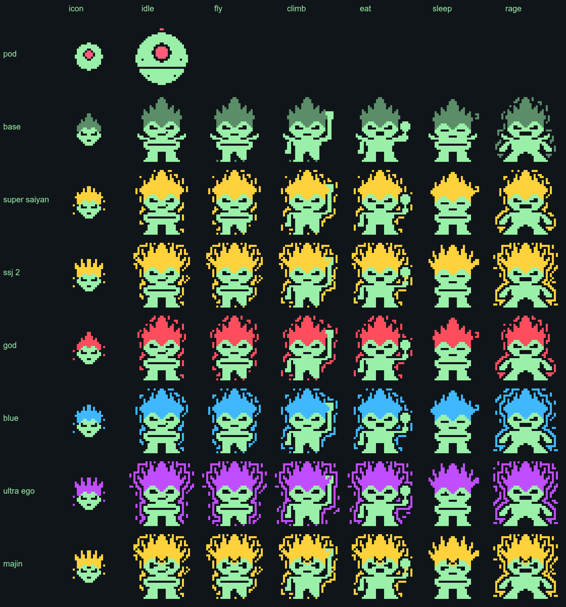

# Ciangotchi

<p align="center">
  
</p>

A small Saiyan prince that lives in your [Omarchy](https://omarchy.org) bar.
He trains while you work, nags you when you slack off, flies around your
screen, and occasionally drags you off to a link you saved and never opened.

A personal, non-commercial fan project, forked from
[Omagotchi](https://github.com/SLcode777/omagotchi) by SLcode777 (MIT; see
[CREDITS.md](CREDITS.md)). Dragon Ball belongs to Akira Toriyama, Toei and
Shueisha.

> Work in progress, built for one person's setup. Things marked TEMP are
> test helpers and will go away.

## Power comes from focus

He grows by **focused time**: a minute counts when you touched the keyboard
or mouse in the last two minutes and you are not on a break. Idle time and
breaks earn nothing.

| Form | Focused time |
| --- | --- |
| Saiyan pod | start |
| Saiyan | 5 min |
| Super Saiyan | 2 h |
| Super Saiyan 2 | 8 h |
| Super Saiyan God | 20 h |
| Super Saiyan Blue | 40 h |
| Ultra Ego | 80 h |

At Ultra Ego, **New Saiyan** retires him: a new pod lands and the generation
counter goes up. **Majin Vegeta** is not on the ladder. While he roams, he
sometimes turns Majin for a minute.

Needs rise with active time: **Hunger** (Feed him), **Rest** (he naps briefly
when exhausted, and rarely: he is not Goku or Beerus), **Training** (roaming
is training) and **Pride** (click him, if you dare).

## He nags you

When you have been idle for a while (default 10 minutes, adjustable in the
settings), he acts up: the bar icon rages, he makes a noise, sometimes sends
a notification in Vegeta's voice, and sometimes gets mischievous and opens a
link (see below). He keeps pestering every few minutes while you stay away.
Idle detection uses the compositor's idle protocol, so it works without a
lock screen or screensaver.

**Take a break** pauses all of it: for a set time (length is adjustable) or
**until back**, when you end it yourself. Breaks earn no power either.

## Links

A nudge, or a click on the roaming pet, opens a random link. Each time he
picks one source at random, then a link from it:

- your own list (`links` in the settings)
- your Brave bookmarks
- [FMHY](https://fmhy.net): about 24,000 links, refreshed daily from
  [their single-page export](https://api.fmhy.net/single-page), with anything
  marked NSFW filtered out
- anything in `~/.local/state/omarchy/ciangotchi-links.d/*.txt` (one URL per
  line). A daily job fills it with your **YouTube Watch Later** videos
  (`yt-dlp`) and your **X bookmarks** ([tweethoarder](https://github.com/tfriedel/tweethoarder)).

Both of those read your login from Brave, only for youtube.com and x.com,
and only when you set the daily job up yourself:

```bash
cp tools/systemd/ciangotchi-links.* ~/.config/systemd/user/
systemctl --user daemon-reload
systemctl --user enable --now ciangotchi-links.timer
```

The scripts are in `tools/` (`refresh-fmhy.sh`, `refresh-youtube.sh`,
`refresh-x.sh`). The X one expects a tweethoarder install at
`~/.local/share/tweethoarder-src/repo`; they assume Brave with the GNOME
keyring. Without them, FMHY and your bookmarks still work.

## Roaming

"Go play" sends him out: a tractor beam carries him from the panel to the
screen. He walks along the bottom and the tops of your windows, and **flies
anywhere on screen**: hovering for a moment, then landing on a window or the
floor. He rides a window if you move it and falls if you close it under him.
He is click-through except for himself. Pick him up and drag him anywhere;
drop him from too high and he is dizzy for a few seconds. A click is a
petting, and it fetches a link. "Come home" calls him back.

## Settings

The cogwheel in the panel has idle minutes, nudges on/off, break length,
sound volume and roam screen. The rest live in
`~/.local/state/omarchy/ciangotchi-settings.json`:

| Key | Meaning |
| --- | --- |
| `idleMinutes` | idle time before a nudge (default 10) |
| `mischiefChance` | chance a nudge also opens a link (default 0.25) |
| `breakMinutes` | length of the timed break (default 30) |
| `links` | your own list of URLs |
| `includeBookmarks`, `includeFmhy` | turn those sources off |
| `clickOpensLink` | whether a click on the roaming pet fetches a link |
| `roamScale` | on-screen size of an art pixel while roaming (default 2) |

The file is read when the plugin loads, and the pet overwrites it when you
use the panel. To edit it by hand, change it and then save any plugin file
(or restart the shell) so it reloads.

## Looks and sounds

Sprites are 32×32 with a 16×16 head icon for the bar, in two layers: the body
follows your theme's colour, and the hair and aura use each form's own colour
(Base has dark hair). Forms are made by `tools/make-forms.py`, which writes
text grids into `tools/sprites/`; `tools/gen-sprites.sh` turns those into the
PNGs (needs ImageMagick). Edit a grid by hand and re-run the second script.
Careful: re-running `make-forms.py` regenerates every grid.

Sound effects are small placeholders from the original project (see
[CREDITS.md](CREDITS.md)). Each event has a slot in `eventSounds` in
`Service.qml`, so clips can be swapped without touching anything else.

## Install

Clone it into your Omarchy plugins folder and enable it:

```bash
git clone git@github.com:mutaician/ciangotchi.git \
  ~/.config/omarchy/plugins/mutaician.ciangotchi
```

Then add `{ "id": "mutaician.ciangotchi" }` to a bar section in
`~/.config/omarchy/shell.json` and restart the shell
(`omarchy-restart-shell`).

State files (safe to delete) are in `~/.local/state/omarchy/`:
`ciangotchi-settings.json` and `ciangotchi-state.json`. A save from the old
Omagotchi growth model is migrated into a fresh pod.

## Dependencies

- `pacman-contrib` (`checkupdates`) and `pipewire-audio` (`pw-play`), both
  preinstalled on Omarchy
- `curl`, `xdg-open`: base system
- optional, for the link jobs: `yt-dlp`, `uv` + tweethoarder, Brave

## What it executes, exactly

Fixed argument lists, never interpolated shell strings; nothing elevates
privileges:

- `checkupdates`, `pacman -Qdtq`: read-only, every 30 minutes. Pending
  updates make hunger rise faster.
- `omarchy-notification-send`: nudges and announcements
- `pw-play`: sound effects (not when the volume is 0)
- `xdg-open <url>`: opens a link, http and https only
- `head`, `cat`: read the state files, Brave bookmarks and link files
- `sh tools/refresh-fmhy.sh`: downloads the FMHY export, at most once a day
- the systemd timer, if you install it, runs `tools/refresh-links.sh`:
  `yt-dlp` and tweethoarder with your Brave cookies for youtube.com and
  x.com only. They are read in memory and never printed or written.

Window positions come from the Hyprland IPC through Quickshell.

## Ideas

See [docs/IDEAS.md](docs/IDEAS.md): distraction watcher, sounds, a gravity
room, workspace flights, an AI agent.

## License

Code and sprites: MIT, see [LICENSE](LICENSE). The sound effects keep their
own licenses, listed in [CREDITS.md](CREDITS.md).
